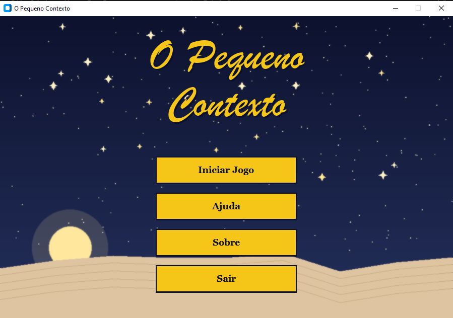
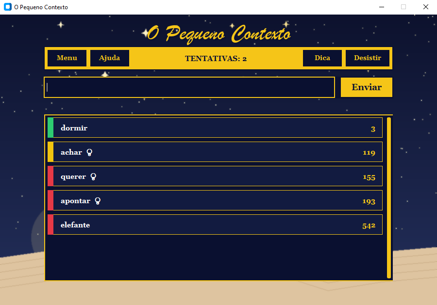
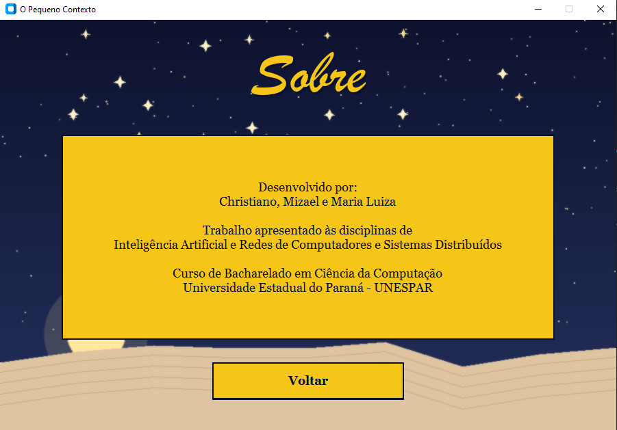
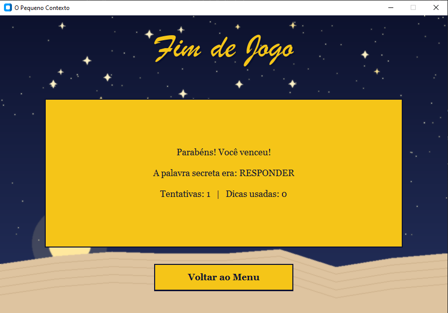

<div align="center">

# 👑 O Pequeno Contexto

**A semantic word-guessing game based on the universe of *The Little Prince***  
*Um jogo de adivinhação semântica baseado no universo de O Pequeno Príncipe*

[](https://www.python.org/)
[](https://spacy.io/)
[-2939b3?style=flat-square)]()
[]()

[🇺🇸 English Version](#english) • [🇧🇷 Versão em Português](#portugues) • [🖼️ Images / Imagens](#imagens)

</div>

---

<a id="english"></a>

## English

### About the Project

**O Pequeno Contexto** is a desktop semantic word-guessing game inspired by [Contexto](https://contexto.me/), developed as an integrative academic project for the **Artificial Intelligence** and **Computer Networks & Distributed Systems** courses in the B.Sc. in Computer Science program at **Universidade Estadual do Paraná (UNESPAR)**.

Unlike the traditional web version, which relies on general internet corpora, this application dynamically builds its semantic universe directly from the Portuguese text of Antoine de Saint-Exupéry's ***O Pequeno Príncipe*** (*The Little Prince*). At the start of every match, the server randomly picks a secret word from the book's vocabulary, and the player must discover it through unlimited guesses ranked by **semantic proximity** (where position `1` represents the secret word).

> **Language Notice:** Because this project was developed for a Brazilian university course and uses the Portuguese edition of *The Little Prince* along with Portuguese NLP models (`pt_core_news_md` and Stanza `pt`), **the entire game—including the user interface, valid vocabulary, hints, and source code comments is exclusively in Portuguese.**

### Features & Game Mechanics

- **Book-Driven Semantic Universe:** All valid guesses and secret words come exclusively from the vocabulary of *O Pequeno Príncipe*.
- **Unlimited Guesses & No Timer:** Players can freely explore semantic relationships between words without time pressure.
- **Color-Coded Proximity Feedback:**
  * 🟩 **Green:** Very close to the secret word (top 2% of the ranking).
  * 🟨 **Yellow:** Moderately close (top 20% of the ranking).
  * 🟥 **Red:** Semantically distant from the target.
- **Smart Hint System:** Provides an unguessed word closer to the secret target than the player's current best guess, scaling its jump size based on how close the player already is.
- **Give Up & Summary:** Reveals the secret word along with the top 5 closest terms in the book's vocabulary and match statistics.

### Architecture & How It Works

The system is built on a decoupled **Client-Server architecture** communicating via **XML-RPC** (`localhost:9876`):

- **Server (`servidor.py`):** Concentrates all Natural Language Processing (NLP) and game state logic:
  * **Text Extraction & Normalization:** Extracts pages 15–206 from `recursos/livro.pdf` using `pdfplumber` and removes accents/casing via `unidecode`.
  * **Lemmatization & Filtering:** Uses **Stanza** (`pt`) for morphological lemmatization (grouping verb conjugations and noun variations), applies custom lemmatization fixes, removes custom Portuguese stopwords, and builds a filtered vocabulary of **718 recurring terms** (minimum frequency of 2).
  * **Semantic Ranking:** Maps vocabulary tokens to pre-trained dense word embeddings using **spaCy** (`pt_core_news_md`) and computes **Cosine Similarity** from scratch to rank the entire vocabulary relative to the secret word.
- **Client (`cliente.py` & `estilo.py`):** Handles only UI rendering and user interaction via **CustomTkinter** and **Pillow**, including custom typography, confirmation dialogs, and request locking to prevent concurrent RPC collisions.

### Project Structure

```text
├── cliente.py              # Graphical User Interface (XML-RPC Client)
├── servidor.py             # NLP Pipeline, Semantic Engine & XML-RPC Server
├── estilo.py               # UI color palette, typography, and widget styles
├── vocabulario_gerado.txt  # Extracted 718-word vocabulary with occurrence counts
├── README.md               # Project documentation
├── imagens/                # Interface screenshots
└── recursos/
    ├── livro.pdf           # Source text (O Pequeno Príncipe)
    ├── fundo.png           # Custom background artwork
    └── fonte.ttf           # Custom title typography
```

### Installation & Running

1. **Clone the repository:**
   ```bash
   git clone [https://github.com/christianombosso/O-Pequeno-Contexto.git](https://github.com/christianombosso/O-Pequeno-Contexto.git)
   cd O-Pequeno-Contexto
   ```

2. **Install the required dependencies:**
   ```bash
   pip install customtkinter pillow pdfplumber spacy stanza unidecode
   ```

3. **Download the Portuguese NLP models:**
   ```bash
   python -m spacy download pt_core_news_md
   python -c "import stanza; stanza.download('pt')"
   ```

4. **Start the Server (Terminal 1):**
   ```bash
   python servidor.py
   ```
   *Wait until the console displays `vocabulario processado`, `vetores carregados`, and `servidor iniciado`.*

5. **Start the Client (Terminal 2):**
   ```bash
   python cliente.py
   ```

---

<a id="portugues"></a>

## Português

### Sobre o Projeto

**O Pequeno Contexto** é um jogo desktop de adivinhação semântica de palavras inspirado no [Contexto](https://contexto.me/), desenvolvido como trabalho integrador das disciplinas de **Inteligência Artificial** e **Redes de Computadores e Sistemas Distribuídos** do curso de Bacharelado em Ciência da Computação da **Universidade Estadual do Paraná (UNESPAR)**.

Diferente da versão web tradicional, que utiliza bases genéricas da internet, esta aplicação constrói seu universo semântico diretamente a partir do texto em português da obra ***O Pequeno Príncipe***, de Antoine de Saint-Exupéry. A cada partida, o servidor sorteia uma palavra secreta do vocabulário do livro e o jogador deve descobri-la por meio de tentativas ilimitadas ordenadas por **proximidade semântica** (onde a posição `1` corresponde à resposta certa).

### Funcionalidades e Mecânicas

- **Universo Semântico Baseado no Livro:** Todos os palpites válidos e palavras secretas pertencem exclusivamente ao vocabulário de *O Pequeno Príncipe*.
- **Tentativas Ilimitadas e Sem Cronômetro:** Permite explorar livremente as relações semânticas entre as palavras sem limite de tempo.
- **Feedback Visual por Cores:**
  * 🟩 **Verde:** Muito próximo da palavra secreta (top 2% do ranking).
  * 🟨 **Amarelo:** Razoavelmente próximo (top 20% do ranking).
  * 🟥 **Vermelho:** Distante semanticamente da resposta.
- **Sistema de Dicas Inteligente:** Fornece uma palavra ainda não tentada que esteja mais próxima da resposta do que o melhor palpite atual do jogador, ajustando o avanço conforme a proximidade já alcançada.
- **Desistência e Resumo:** Revela a palavra secreta junto com as 5 palavras mais próximas no vocabulário do livro e as estatísticas da partida.

### Arquitetura e Funcionamento

O sistema utiliza uma arquitetura **Cliente-Servidor** desacoplada com comunicação via **XML-RPC** (`localhost:9876`):

- **Servidor (`servidor.py`):** Concentra todo o pipeline de Processamento de Linguagem Natural (PLN) e a lógica de estado da partida:
  * **Extração e Normalização:** Extrai o conteúdo das páginas 15 a 206 de `recursos/livro.pdf` com `pdfplumber` e normaliza acentuação e caixa com `unidecode`.
  * **Lematização e Filtragem:** Utiliza o **Stanza** (`pt`) para lematização morfológica (agrupando conjugações verbais e variações nominais), aplica correções manuais de lemas, remove *stopwords* customizadas e monta um vocabulário filtrado de **718 palavras relevantes** (frequência mínima de 2 ocorrências).
  * **Ranking Semântico:** Mapeia os termos para vetores densos (*word embeddings*) utilizando o **spaCy** (`pt_core_news_md`) e calcula a **Similaridade por Cosseno** para ranquear todo o vocabulário em relação à palavra secreta.
- **Cliente (`cliente.py` & `estilo.py`):** Responsável exclusivamente pela interface gráfica e interação com o usuário via **CustomTkinter** e **Pillow**, contando com tipografia personalizada, janelas de confirmação e trava de requisições para evitar chamadas simultâneas ao servidor.

### Estrutura do Projeto

```text
├── cliente.py              # Interface gráfica (Cliente XML-RPC)
├── servidor.py             # Pipeline de PLN, cálculo semântico e Servidor XML-RPC
├── estilo.py               # Paleta de cores, fontes e estilos dos componentes
├── vocabulario_gerado.txt  # Vocabulário extraído (718 palavras) com frequência
├── README.md               # Documentação do projeto
├── imagens/                # Capturas de tela da interface
└── recursos/
    ├── livro.pdf           # Texto-base (O Pequeno Príncipe)
    ├── fundo.png           # Imagem de fundo das telas
    └── fonte.ttf           # Fonte personalizada dos títulos
```

### Instalação e Execução

1. **Clone o repositório:**
   ```bash
   git clone [https://github.com/christianombosso/O-Pequeno-Contexto.git](https://github.com/christianombosso/O-Pequeno-Contexto.git)
   cd O-Pequeno-Contexto
   ```

2. **Instale as dependências:**
   ```bash
   pip install customtkinter pillow pdfplumber spacy stanza unidecode
   ```

3. **Baixe os modelos de PLN em português:**
   ```bash
   python -m spacy download pt_core_news_md
   python -c "import stanza; stanza.download('pt')"
   ```

4. **Inicie o Servidor (Terminal 1):**
   ```bash
   python servidor.py
   ```
   *Aguarde as mensagens `vocabulario processado`, `vetores carregados` e `servidor iniciado` no terminal.*

5. **Inicie o Cliente (Terminal 2):**
   ```bash
   python cliente.py
   ```

---

<a id="imagens"></a>

## 🖼️ Images / Imagens

<div align="center">

| Main Menu / Menu Principal | Gameplay / Tela do Jogo |
| :---: | :---: |
|  |  |

| How to Play / Como Jogar | About / Sobre |
| :---: | :---: |
|  |  |

| Victory Screen / Tela de Vitória | Give Up Screen / Tela de Desistência |
| :---: | :---: |
|  |  |

</div>
